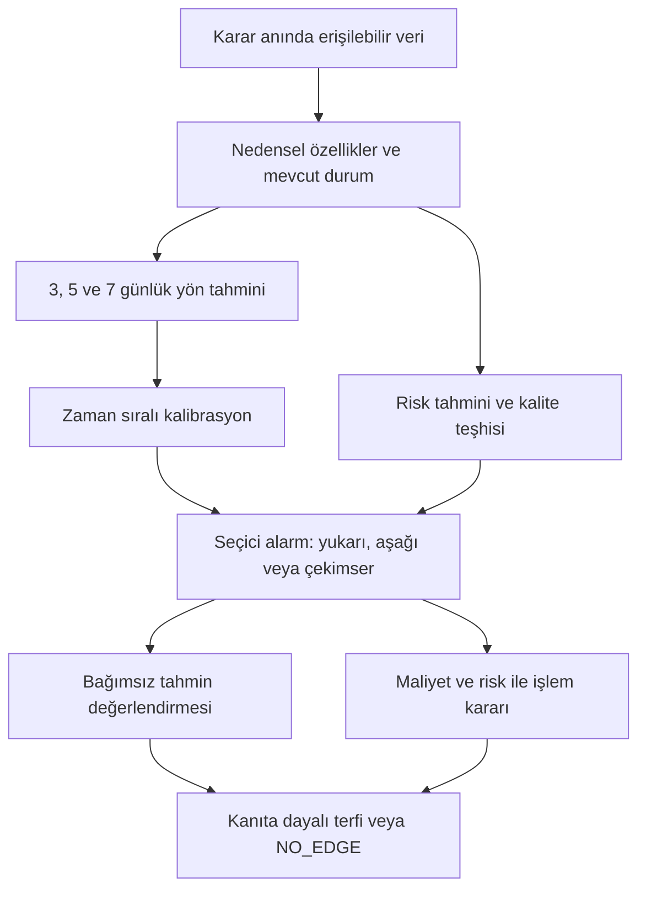

# ONEFILE — Rejim ve Trend Tahmini: Tam Araştırma ve Mimari Tasarım

**Sürüm:** 2.0 · **Araştırma tarihi:** 18 Ekim 2026  
**Karar:** Mevcut sonuç **NO_EDGE** olarak korunuyor. Bu belge, bu sonucu aşmak için uygulanabilir bir araştırma ve mimari tasarımıdır; yeni bir performans sonucu değildir.  
**Kapsam:** Kripto perpetual futures; yönlü long/short/cash; 3–7 günlük tahmin; azami 21 günlük pozisyon. Arbitraj stratejisi yok.  
**Bu çalışmada yapılan:** Mevcut raporun okunması, birincil literatür ve veri dokümantasyonunun araştırılması, hedeflerin ve deneylerin tasarlanması. Model eğitilmedi, araştırma kodu veya backtest çalıştırılmadı, veri indirilmedi, depo değiştirilmedi, sealed OOS açılmadı.

## 1. Tasarım kararı

ONEFILE'ın bir sonraki sürümü, **mevcut rejim tespitinin yanına gelecekteki yön ve devam olasılığını tahmin eden ayrı bir katman** eklemeli. Başlangıç noktası yeni bir araştırma platformu kurmak değil, mevcut `one.py` içindeki hedef, özellik ve değerlendirme sözleşmelerini değiştirmektir.

Önerilen ilk soru:

> Bugün gözlenebilen hareketin gücü, yaşı, oynaklığı ve katılımı verildiğinde, önümüzdeki beş günün anlamlı net yönü yukarı mı, aşağı mı, yoksa belirsiz mi olacak? Erken aşamada yakaladığımız hareketlerin hangileri devam edecek?

Ana model, düzenlileştirilmiş çok sınıflı lojistik regresyon. Rakibi, kapasitesi sınırlı XGBoost. Mevcut başarılı parçalar ve eski sonuçlar referans olarak korunur. Volatilite tahmini yardımcı çıktı olur; yön tahmininin yerine geçirilmez. Spot akışı, funding ve OI ancak fiyat tabanlı rakibe ilave bilgi katarlarsa tutulur.

İlk hedef, bütün günlerde %80 doğruluk ilan etmek değildir. **Önceden belirlenmiş bir fırsat sıklığında ve kabul edilebilir kaçırma oranında güvenilir yön tahmini** üretmektir. %80 seçilmiş alarm precision'ı ayrı bir üst hedeftir. Mimari, hedefe ulaşılamadığında bunu dürüstçe gösterebilmelidir.

Bu öneri bir literatür sentezi ve tasarım çıkarımıdır. Bir makalenin başarılı sonucu, aynı yöntemin ONEFILE'da çalıştığını göstermez.

## 2. Mevcut kanıt ne söylüyor?

| Bilgi | Kaynak ve kanıt düzeyi | Kullanım |
|---|---|---|
| Rejim başlangıcı AP yaklaşık 0,116; olay önseli yaklaşık 0,110 | Yüklenen önceki raporda aktarılan sonuç; ham tahminler burada yeniden incelenmedi | Yaklaşık 0,006 mutlak fark, tek başına anlamlı üstünlük kanıtı sayılamaz |
| En son PR hâlâ NO_EDGE | Kullanıcının güncel bildirimi; bu çalışmada PR numarası/diff'i doğrulanmadı | Yeni mimarinin başlangıç durumu |
| Rejimleri bulabiliyoruz | Kullanıcının gözlemi; nedensel ve geriye dönük tespit ayrımı henüz burada ölçülmedi | Tespit bileşenini koru; erişilebilirlik denetimini tasarla |
| Yeni mimarinin yön doğruluğu, AP'si, net getirisi | Ölçülmedi | Boş bırakılmalı; literatür rakamlarıyla doldurulmamalı |
| %80+ başarı | Hedef | Gerçekleşmiş sonuç gibi sunulmamalı |

Eski AP ile yeni hedefin AP'si doğrudan karşılaştırılamaz: hedef ve önsel değişirse problem de değişir. Eski başlangıç hedefine dönük performans, yeni deneylerin yanında ayrı bir sütunda tutulmalı.

NO_EDGE, mevcut deneyde yeterli kanıt bulunmadığını söyler. Bütün olası yön sinyallerinin imkânsız olduğunu kanıtlamaz. Buna karşılık, model adını değiştirmenin sorunu çözeceğine dair kanıt da sağlamaz.

## 3. Birbirine karıştırılmaması gereken dört görev

| Görev | Ne zaman bilinir? | Ne ölçülmeli? |
|---|---|---|
| Geriye dönük rejim etiketleme | Gelecek fiyatlar görüldükten sonra | Rejimlerin ekonomik anlamı, sınırların kararlılığı |
| Bugünkü rejimi nedensel tespit | Yalnız karar anına kadarki verilerle | Gecikme, yanlış geçiş, filtrelenmiş durum |
| Gelecek rejimi/yönü tahmin | Gelecek gerçekleşmeden önce | Proper loss, yön AP'si, alarm precision/recall |
| Tahmini işleme dönüştürme | Tahmin üretildikten sonra | Maliyet sonrası getiri, risk, uygulanabilirlik |

Birinci görevde güzel bir grafik elde etmek üçüncü görevde başarı anlamına gelmez. İkinci görevde bugünkü yükselişi tanımak da beş günlük devamı bildiğimiz anlamına gelmez. Rejim tanımlama ile tahmini açıkça ayıran JM–XGB çalışması bu ayrım için doğrudan ilgili bir örnektir [R03].

Özellikle **gelecek kullanılarak düzeltilmiş HMM/HSMM durumları, tüm dönem Viterbi yolu, merkezlenmiş ortalamalar ve yeniden boyanan dönüş noktaları**, karar anındaki özellik olarak kullanılamaz. Bunlar ancak sınırları doğru çizilmiş eğitim etiketleri veya sonradan değerlendirme araçları olabilir.

Bir trendin ilk hareketini görmek çoğu zaman mümkündür; ilk hareketin devam edeceğini bilmek başka bir istatistiksel sorudur. Yeni mimari ikinci soruyu hedefler. Başlamadan önce geçiş tahmini bağımsız bir deney olarak açık tutulur.

## 4. Literatür taramasının kapsamı ve ağırlıklandırılması

Tarama; arXiv'deki trend/momentum, dönüş ve değişim noktası, rejim tahmini, kripto mikro yapı, tablosal öğrenme, kalibrasyon, zaman serisi belirsizliği ve değerlendirme yanlılığı başlıklarını kapsadı. ArXiv dışındaki özgün makaleler, yazar kopyaları, üniversite kayıtları ve borsa dokümantasyonu tamamlayıcı olarak kullanıldı.

**Tüm arXiv'in eksiksiz tarandığı iddia edilmiyor.** Bu, 18 Ekim 2026'ya kadar erişilebilen kaynaklarda yapılmış geniş ve hedefli bir taramadır; indeks kapsamı ve erişim kısıtları vardır. Ek A'da 36 kaynak, Ek B'de sorgu izi ve erişim düzeyi bulunur. Tam metnine erişilemeyen çalışmaların sonuçları özet düzeyinde ele alındı. Çalışmaların deneyleri burada yeniden üretilmedi.

Kanıt sıralaması: aynı piyasa ve aynı tahmin ufkunda gerçek zaman sıralı test > başka piyasadaki zaman sıralı test > betimleyici rejim analizi > yalnız eğitim başarısı. Bir çalışma yönü değil volatiliteyi tahmin ediyorsa, yön tahmini için doğrudan kanıt sayılmadı.

### 4.1. Mimariyi etkileyen bulgular

| Kaynak | İlgili bulgu | ONEFILE'a alınacak fikir | Aktarım sınırı |
|---|---|---|---|
| Safari–Schmidhuber, 2025 [R01] | Geleneksel piyasalarda trend/devam ve dönüş davranışı ufka ve trend gücüne bağlı | Birkaç ufuk, hareket gücü, doygunluk | Kriptoya ve %80'e doğrudan kanıt yok |
| Schmidhuber, 2020 [R02] | Güçlü trendlerin dönüşünü doğrusal olmayan terimlerle araştırıyor | Güç ile devam arasında düz çizgi varsayma | Küçük tahmin etkileri yüksek kesinlik demek değil |
| Shu–Yu–Mulvey [R03] | Rejim etiketleme ve sonraki dönem tahminini ayıran jump model + GBDT tasarımı | Mevcut tespiti koru, ayrı forecaster ekle | Çalışma uzun tarihli geleneksel varlıklar ve bir günlük hedef kullanıyor |
| Wood–Roberts–Zohren [R04] | Değişim noktası bilgisini momentum modeline yardımcı bilgi olarak ekliyor | Geçiş şiddeti ve nedensel hareket yaşı | CPD, gelecekteki yönü tek başına bildirmiyor |
| Lim–Zohren–Roberts [R05] | Trend tahmini ve pozisyonu birlikte öğreniyor; maliyet duyarlılığı inceleniyor | Tahmin ile ekonomik karar arasında açık bağ | 88 futures üzerinde sonuç; küçük kripto örneklemine doğrudan taşınamaz |
| Few-shot trend çalışması [R06] | Yeni rejimlere uyum için bağlam benzerliği kullanıyor | Rejimler arası bilgi paylaşımı | İlgili metinde ana deneyin maliyeti sıfır; net edge dayanağı değil |
| Fang–Ślepaczuk, 2026 [R07] | Daha iyi rejim/volatilite modeline rağmen yön tahmini zayıf ve koşula bağlı kalabiliyor | Yön kazanımını ayrı ölç; yüksek-vol filtresini otomatik üstün sayma | Çin hisse endeksi; tam metin erişimi sağlanamadı |
| Bysik–Ślepaczuk, 2026 [R08] | Saatlik BTC tahminlerinde naif işleme dönüşüm maliyet sonrası bozuluyor; seçicilik önemli | Alarm ve işlem eşiğini ayır, turnover ölç | En iyi konfigürasyon model üstünlüğünün sağlam istatistiksel kanıtı değil |
| Kim–Hansen, 2026 [R09] | Binance perpetual akışında belirli saat fazlarında kısa ufuklu öngörülebilirlik araştırılıyor | Özelliğin ufkunu ve zamanını açık tanımla | Saniye/saat sonucu 3–7 güne genellenemez; brüt etki maliyete küçük kalabiliyor |
| AdaptiveTrend, 2026 [R10] | Kriptoda momentum, risk ve evren seçimini birleştiriyor | Trend/vol/risk ayrımı değerlendirilebilir | Yazar raporu; geniş coin evreni, seçim ve yeniden üretim denetimi gerekli |
| Cortese–Kolm–Lindström [R13] | Kripto rejimlerini sparse jump model ile açıklıyor | Trend, aktivite, attention gibi mekanizma grupları | Açıklayıcı rejim başarısı ileri tahmin başarısıyla aynı değil |
| Cont–Kukanov–Stoikov [R14] | Kısa aralıklarda order-book imbalance ile fiyat etkisini inceliyor | Akışı fiyatla aynı şey saymama | Kline taker oranı gerçek emir defteri OFI değildir; günler ufku ayrıca test edilmeli |

Literatürün ortak tasarım katkısı, çok sayıda indikatör eklemekten çok **hedefi doğru kurmak, ufukları ayırmak, nedensel durum kullanmak ve güçlü baselineları yenmek**. Bu cümle araştırma sentezidir; bütün makalelerin aynı sonucu kanıtladığı anlamına gelmez.

### 4.2. Yeni modellerden ne alınmıyor?

Transformer, LSTM, foundation model, RL veya çok sayıda uzmanı aynı anda kurmak ilk aşamada gerekçelendirilmiş değil. Tablosal öğrenme karşılaştırmaları [R16] sığ ağaç modellerini ciddi rakip olarak destekler; finansal üstünlük garantilemez. Rejim farkındalığı kullanan LLM volatilite araştırması [R24] ilginçtir, ancak pahalı çıkarımı ve farklı hedefi ONEFILE için başlangıç seçimi yapmayı gerektirmez.

BiLSTM geçmişten oluşan bir pencere içinde çift yönlü çalışıyorsa otomatik olarak leakage demek değildir. Sızıntıyı belirleyen, pencereye karar sonrasının girip girmediğidir. Aynı şekilde etikette gelecek kullanmak normaldir; bu bilginin modele, örnek seçimine veya bölme sınırlarına sızması hatadır.

## 5. Hangi mekanizmaları sınayacağız?

| Mekanizma hipotezi | Gözlenebilir vekil | Beklenen karar bilgisi | Yanlışlanma koşulu |
|---|---|---|---|
| Yavaş bilgi yayılımı / pozitif geri besleme | Birkaç ufukta normalize momentum, hacim katılımı | Yeni ve aşırı uzamamış hareketin devamı | Basit momentumdan iyi koşullu tahmin yok |
| Trend doygunluğu | Hareketin büyüklüğü, yaşı, hızlanma ve geri çekilmesi | Güç arttıkça devamın sonsuza dek artmaması | İlave biçim terimleri dış dönemde katkısız |
| Spot katılımıyla desteklenen hareket | Spot taker oranı ve perp oranından farkı | Aynı fiyat hareketinde devam olasılığı farkı | Eşleşmiş örneklemde fiyat+vol rakibi yenilemiyor |
| Kaldıraç birikmesi ve çözülmesi | Fiyat etkisinden arındırılmış OI, geçmiş funding, prim | Risk, devam veya dönüş koşullarını ayırma | Sadece oynaklığı açıklıyor; yön kazanımı yok |
| Piyasa geneline yayılan hareket | BTC/ETH eşzamanlı katılımı, varsa sabit evren breadth | Tekil sıçrama ile ortak hareketi ayırma | Zaman gruplaması sonrasında katkı kayboluyor |
| Volatilite kümelenmesi | Geçmiş RV/EWMA/HAR bileşenleri | Gelecek riskin tahmini | Güçlü volatilite baseline'ı yenilemiyor |

Bu değişkenler mekanizmanın doğrudan ispatı değil, ölçülebilir vekilleridir. OI artışından tek başına net long talebi çıkarılamaz; açık kontratın iki tarafı vardır. Spot taker alış baskısı da uzun vadeli yatırımcı talebinin birebir ölçümü değildir. Funding pozitifken otomatik short açılmaz.

**Öncelik değişikliği:** Eski raporun “önce volatilite, sonra belki yön” sırası yerine yön/devam deneyi ana çalışma olur. Volatilite aynı veri sözleşmesiyle bağımsız ölçülür. Böylece asıl hedef bir yardımcı görevin başarısıyla ikame edilmez.

## 6. Dondurulacak araştırma alanı

| Bileşen | İlk sürüm kararı |
|---|---|
| Varlıklar | BTCUSDT ve ETHUSDT; mevcut kapsamla uyum teyit edilerek. Altcoin taraması ilk kanıtın şartı değil |
| Pozisyon | Tek yönlü perpetual long/short/cash; spot hedge, cash-and-carry veya funding toplama stratejisi yok |
| Ham veri | Mümkünse mevcut doğrulanmış 1h veriler; günlük özellik/tahmin için birleştirme |
| Karar saati | Her gün aynı UTC kapanışından sonra; verinin kullanılabilir olmasına yetecek sabit gecikme |
| Ana ufuk | 5 takvim günü |
| Yardımcı ufuklar | 3 ve 7 gün; ana sonuç başarısızken en iyi ufuk seçilip başarı ilan edilmez |
| İşlem üst sınırı | Ekonomik doğrulamada 21 gün; ilk yön hedefi beş gün olmaya devam eder |
| Tarih kapsamı | En az dört yıllık uygun veri hedefi; mevcut DEV/SEALED ayrımı üstün gelir |
| Eklemeler | Yeni coin, karar saati, pencere veya etiket değişikliği yeni araştırma kararı olarak kaydedilir |

Dört yıllık fiyat geçmişi bulunması dört yılın tamamının araştırmaya açık olduğu anlamına gelmez. Mevcut sealed döneme erişim gerektiriyorsa kullanılamaz. Eski projelerde veya PR'larda görülmüş tarihler yeni holdout diye yeniden adlandırılmaz.

İlk sürümde günlük karar, 3–7 günlük amaçla uyumlu ve deneme sayısını sınırlayan bir başlangıç tercihidir. 6h karar frekansı bir sonraki bağımsız deney olabilir; günlük hedef zayıf çıkınca altı saatlik tekrarları bağımsız örnek gibi saymak çözüm değildir.

## 7. Hedef sözleşmesi: gelecekte tam olarak neyi tahmin ediyoruz?

### 7.1. Notasyon ve zaman çizgisi

`t`, tamamlanmış günlük barın sonudur. `I_t`, ancak o anda veya önceden belirlenmiş karar gecikmesi sonunda erişilebilen bilgidir. `p_t`, işlemi yapılacak USDⓈ-M perpetual'ın last-trade günlük kapanışının log fiyatı; `r_t=p_t-p_(t-1)` günlük log getiridir. Spot fiyat özellik kaynağıdır; mark/index fiyatı risk ve sözleşme hesabında ayrı tutulur. Mevcut ONEFILE etiketi farklı fiyat kaynağındaysa bu değişiklik yeni hedef sürümü olarak kaydedilir; seriler sessizce birbirine karıştırılmaz.

`s_t`, yalnız geçmiş günlük getirilerden hesaplanan bir günlük risk ölçeğidir. İlk tanım: EWMA kare getiri ortalamasının karekökü; yarı ömür 21 takvim günü. Bu bir ön tasarım tercihi, ampirik optimum iddiası değildir. Sayısal taban ve geçersiz/sıfıra yakın volatilite kuralı eğitim öncesi sabitlenir.

Gelecek normalize getiri:

\[
Z_{t,h}=\frac{p_{t+h}-p_t}{s_t\sqrt{h}},\qquad h\in\{3,5,7\}.
\]

`sqrt(h)` burada ortak bir ölçekleme sözleşmesidir; kripto getirilerinin bağımsız normal olduğunu veya bunun doğru h-günlük volatilite tahmini olduğunu iddia etmez. Her örnekte payda karar anında dondurulur.

### 7.2. Ana yön etiketi

\[
Y^D_{t,h}=\begin{cases}
\mathrm{UP} & Z_{t,h}>0.75,\\
\mathrm{DOWN} & Z_{t,h}<-0.75,\\
\mathrm{NEUTRAL} & \text{diğer durumlar.}
\end{cases}
\]

0,75 eşiği ekonomik anlamı olan hareketleri çok küçük net değişimden ayırmak için **önceden önerilen başlangıç sabiti**. Çalışmalar bu sayının ONEFILE için en iyi eşik olduğunu göstermiyor. İlk dağılım/örnek yeterliliği incelemesi yalnız eğitim bölümünde yapılır ve test öncesi dondurulur. 0,50 ve 1,00 eşikleri, ancak önceden kaydedilmiş duyarlılık analizi olarak raporlanır; içlerinden en iyi olan terfi ettirilmez.

`NEUTRAL`, “gelecek yol boyunca hiç trend olmadı” demek değildir. Başlayıp geri dönen büyük bir hareket de düşük net değişimle bitebilir. Bu nedenle net yön ve yol kalitesi ayrı raporlanır. Üç sınıflı yön modeline bütün uygun günler girer; yalnız sonradan güzel trend olduğu görülen günler seçilmez.

### 7.3. Yol kalitesi ve risk hedefleri

\[
Q_{t,h}=\frac{|p_{t+h}-p_t|}{\sum_{j=1}^{h}|r_{t+j}|+\varepsilon}.
\]

`Q`, günlük gözlemlerde net hareketin toplam yola oranıdır. Yüksek değer, günlük ölçekte daha tutarlı yön demektir. Gün içi zikzakları ölçmez; 1h yoldan hesaplanan karşılığı ayrıca tanımlanırsa ayrı isim taşır. Gelecek Q etiket/teşhis içindir; bugünkü özellik olarak kullanılamaz.

Risk hedefi, sonraki h günün saatlik kare log getirileri toplamından üretilen gerçekleşen varyanstır. Birincil risk tahmini sürekli değer, değerlendirme QLIKE ve log ölçekte hatadır. Yüksek-risk etiketi gerekiyorsa eşik yalnız eğitimin içinde seçilir; tüm dönemin yüzdelikleri kullanılmaz.

**İlk çalışan sürümün zorunlu öğrenilmiş çıktısı yön olasılıklarıdır.** Q başlangıçta teşhis hedefi, risk ise EWMA/HAR baseline tahmini olabilir. Ayrı öğrenilmiş Q/risk başlığı yalnız kendi baseline üstünlüğünü gösterirse kalıcılaşır. Bu üçü mutlaka tek büyük sinir ağına dönüştürülmez.

### 7.4. Erken devam ve başlangıç tahmini

İki günlük geçmiş hareketin yönü `d_t=sign(p_t-p_(t-2))` olsun. Erken-devam kohortu için başlangıç önerisi:

- İki günlük hareketin normalize mutlak büyüklüğü 0,25–1,50 arasında.
- Nedensel hareket yaşı en fazla iki gün.
- Veri ve likidite uygun; diğer şartlar gelecekten seçilmiyor.

Bu kohort yalnız geçmişe dayanır. Kohort eşikleri ilk eğitim bölümünde yeterlilik açısından kontrol edilip dondurulur; sonradan yüzdeyi yükseltmek için daraltılmaz. Devam skoru `P(Y^D_(t,5)=d_t | I_t)` olur. Her uygun başlangıç gözlenir; başarısız ve sahte başlangıçlar örneklemde kalır.

**Başlangıçtan önce tahmin**, mevcut rejimden farklı, ileriye dönük bir rejimin başlaması için ayrı olay hedefidir. Tarihsel başlangıç etiketleri kullanılacaksa bunların ufku, etiket olgunlaşma tarihi ve eşleme kuralı kaydedilir. Bu deneyin NO_EDGE sonucu, erken-devam deneyinde iyi sonuç alınmasıyla silinmez. Erken devam başarısı da “başlamadan önce bildik” diye sunulmaz.

## 8. Özellik tasarımı: indikatöre izin var, sınırsız taramaya yok

İndikatörler fiyat/hacim bilgisinin dönüşümüdür; aynı bilginin farklı isimlerini eklemek yeni bilgi yaratmaz. İlk sürüm az sayıdaki mekanizma grubunu sınar. Parametreleri geniş grid'de tarayarak seçmek yerine küçük, önceden yazılmış sözleşme kullanılır.

### 8.1. Çekirdek: 12 özellik

| No | Özellik | Tanım / gerekçe |
|---|---|---|
| 1–4 | `m_1,m_3,m_7,m_21` | Geçmiş k-gün log getirisi / `(s_t sqrt(k))`; kısa ve uzun hareket |
| 5 | `accel_3` | Bugünkü `m_3` ile önceki kararın `m_3` farkı; hızlanma |
| 6 | `efficiency_7` | Geçmiş yedi günlük net hareket / toplam mutlak günlük yol |
| 7 | `breakout_position_21` | Bugünkü fiyatın t'den önceki 21 günün yüksek-düşük aralığına göre konumu; üst/alt sınır bugünkü barla güncellenmez |
| 8 | `compression_3_21` | Geçmiş 3 ve 21 günlük saatlik gerçekleşen risk oranı |
| 9 | `log_risk_21` | Mevcut risk düzeyi; oran tek başına ölçeği kaybettirmesin |
| 10 | `relative_volume_3` | Son üç günlük ortalama quote hacmin, önceki 21 günlük ortalamaya oranının log'u |
| 11 | `close_location_1` | Son kapanışın tamamlanmış günün yüksek-düşük aralığındaki normalize yeri |
| 12 | `causal_age` | Nedensel durum aynı yönde kaç karar önce başladı; 21 günde üstten sınırlandırılmış |

Yaş için basit durum makinesi kullanılır: geçmiş `m_3` +0,25 üzerindeyse up, −0,25 altındaysa down, aradaysa neutral. Bu, etiketin kendisi değil, bugün gözlenebilir bir bağlam değişkenidir. Yaş sıfırdan başlar; sonradan bulunan dip/tepeye geri taşınmaz. Sınır ve durum tanımı ilk testten önce sabitlenir.

Lojistik modele en fazla iki önceden belirlenmiş biçim terimi eklenebilir: `m_3*abs(m_3)` ve `m_3*log1p(causal_age)`. Bunlar çok güçlü/yaşlı hareketin farklı davranmasına izin verir; veri incelenerek sınırsız etkileşim üretilmez. Kübik momentum da bu terimlerin yerine alternatif deney sayılır, ücretsiz ek değildir.

RSI, MACD, ADX, Bollinger genişliği, ATR, Donchian konumu kullanılabilir. Ancak ilk turda mevcut grubun temsilcisinin yerine geçerler. Örneğin Bollinger genişliği sıkışma, ADX tutarlılık, MACD momentum farkı temsilcisidir. Bunların hepsini aynı anda eklemek öncelik değildir. Kullanılan sürüm tamamen geçmişe bakmalı; göstergeyi hesaplayan paket zaman sınırlarını otomatik olarak güvenli yapmaz.

### 8.2. Spot katılımı: üç yeni bağımsız özellik

`imbalance = 2 * (taker_buy_quote / total_quote) - 1`.

1. Son üç gün spot imbalance.
2. Son üç gün perpetual imbalance.
3. Spot/perp quote hacim oranının log'u.

Spot–perp imbalance farkı bu iki özellikten türetilir; modele ayrı eklenecekse yeni bağımsız bilgiymiş gibi sayılmaz. Agregasyon, bar oranlarının basit ortalamasıyla değil toplanmış quote hacimleriyle yapılır. Spot ve perp aynı takvim penceresine hizalanır.

Bu, agresif işlem tarafı vekilidir. Emir defterindeki limit emir eklemelerini, iptalleri veya gerçek OFI'yi ölçmez [R14, R33].

### 8.3. Türev bağlamı: en fazla dört özellik

- Tamamlanmış funding ödemelerinin geçmiş 21 günlük dağılıma göre normalize düzeyi.
- Geçmiş funding değişimi; ödeme aralığı değişiyorsa süre başına normalize edilir.
- Kontrat/base-unit OI'ın üç günlük log değişimi; USD nominalinin fiyat etkisi ayrılır.
- Aynı anda gözlenen perp/spot veya perp/index priminin geçmişe göre normalize düzeyi.

Funding/OI eksikse ana fiyat modeli çalışabilir. Ancak veri eksiği olduğu için modelin hangi sürümünün çalıştığı açıkça işaretlenir. OI eklenen sürüm, fiyat baseline'ıyla **aynı satırlarda** karşılaştırılır; daha kolay bir örneklemle üstünlük üretmesine izin verilmez.

### 8.4. İlk sürüm dışında kalanlar

Likidasyon heatmap'i, order-book derinliği, opsiyon skew'u, sosyal medya ve haber/LLM sentiment'i için yeterli tarih ve point-in-time kayıt gösterilmedikçe performans iddiası kurulmaz. Bugünkü heatmap geçmişteki pozisyon dağılımını ispatlamaz. Google Trends gibi revize/normalize edilen serilerde bugünkü indirmenin tarihsel erişilebilirlikle aynı olduğu varsayılmaz.

Hurst, Fourier/wavelet, EMD ve merkezlenmiş trend ayrıştırmaları hipotez kaynağı olabilir. Kısa pencerede Hurst >0,5 görülmesi tek başına ileri yön edge'i değildir. Bütün seriyle yapılan ayrıştırma ileri veriyi kullanabilir. Böyle bir aday gelirse yalnız tek taraflı ve sınır etkileri kontrol edilmiş sürümü bağımsız deney olarak alınır.

## 9. Önerilen mimari

### 9.1. Katman A — Baselinelar

Her aday aynı zamanlarda, aynı hedefle ve aynı erişilebilir veriyle şu rakiplere karşı ölçülür:

| Baseline | Amaç |
|---|---|
| Eğitimdeki sınıf frekansları | Sınıf dengesizliğinden gelen kolay başarıyı ayırmak |
| Bugünkü durumun devamı | “Rejimler zaten yapışkan” etkisini ayırmak |
| Son 3/7 gün momentumunun işareti ve büyüklüğü | Yeni modelin basit trend kuralından katkısı |
| Tek normalize momentumlu düzenlileştirilmiş model | Çok özellikli modelin gerçekten bilgi eklemesi |
| Eski ONEFILE modeli | Aynı eski hedefte gerileme ve değişim takibi |
| Riskte EWMA ve HAR türü model | Funding/OI'nin kolay volatilite sürekliliğini aşması |

Deterministik yön kuralları olasılık üretmiyorsa, geçmişteki durumlara ait sınıf frekansları eğitim verisinden yumuşatılarak tahmin edilir. Log-loss için 0/1 kesinlik uydurulmaz.

### 9.2. Katman B — Ana yön modeli

Üç sınıflı multinomial lojistik model, her ufuk için `P(UP), P(DOWN), P(NEUTRAL)` üretir. Toplamları bir olmalıdır. Özellik standardizasyonu ve düzenlileştirme yalnız eğitim kesiminden öğrenilir. 5g birincil, 3g ve 7g yan rapor olur.

Başlangıçta sınıf ağırlığı kullanılmaz. Azınlık sınıfı için ağırlık veya örnekleme gerekiyorsa bunun gerçek önselleri ve kalibrasyonu bozabileceği dikkate alınır. Olasılıklar doğal sınıf sıklıklarına sahip ayrı zaman kesiminde değerlendirilir. Rastgele karıştırılmış SMOTE kullanılmaz.

Özellik sayısı düşük olduğundan lojistik iyi bir bilimsel başlangıçtır: başarısızlık nedenini ayırmak kolay, yeniden eğitim ucuz, yön olasılıklarını yorumlamak mümkündür. Lojistiğin mutlaka kazanacağı varsayılmıyor.

### 9.3. Katman C — Sığ XGBoost rakibi

XGBoost aynı hedef, satırlar, bölmeler ve alarm bütçesinde yarışır [R17]. Başlangıç kapasite merdiveni derinlik 2–3, güçlü yaprak desteği ve düzenlileştirmedir. Ağaç sayısı/öğrenme hızı yalnız geçmiş stopping kesiminde belirlenir. Önceki bir deneyin 30 round seçimi yeni hedefin optimumu sayılmaz.

Önemli nokta, underfitting riskini yalnız küçük modelde ısrar ederek gizlememektir. Şu ayrım yapılmalı:

- Eğitim ve stopping başarısı zayıfsa özellik/etiket sorunu veya yetersiz kapasite araştırılır.
- Eğitim iyi, stopping kötü ise genelleme/shift sorunu vardır.
- Sıralama iyi, calibration kötü ise önce olasılık ölçeği düzeltilir.
- Forecast iyi, net işlem kötü ise maliyet/karar dönüşümü incelenir.

İlk sürümde lojistik ve XGBoost'u otomatik karıştıran öğrenilmiş ensemble yok. En basit yeterli model tutulur. Karşılaştırma farkının belirsizlik aralığı sıfırı içeriyorsa karmaşık modele sırf nokta tahmini daha yüksek diye geçilmez.

### 9.4. Mevcut residual-logit tasarımının yeri

Mevcut kodda yapısal lojistik üzerine residual boosting varsa silinmesi gerekmez. Yeni hedefle ayrı aday olarak değerlendirilebilir:

\[
\mathbf{p}_{t,h}=\operatorname{softmax}\left(\mathbf{z}^{struct}_{t,h}+\alpha\,\mathbf{g}_{t,h}\right).
\]

İkili hedefte karşılığı sigmoid/logit düzeltmesidir. Bu, düz residual getiri regresyonuyla aynı şey değildir. Yapısal skorlar yalnız geçmiş eğitimden veya gerçek zaman sıralı out-of-fold tahminlerden üretilmelidir; kalibratör/stacker eğitim içinde iyi görünen fitted tahminlerle eğitilmez. Residual ve tek XGBoost farklı adaylar sayılır. İlk ayda ikisini de zorunlu yapmak yok.

### 9.5. Risk ve değişim bilgisi

Risk tahminine başlangıçta EWMA/HAR yeterli rakiplerdir [R28]. Funding'in ilave risk bilgisi ayrıca test edilir [R30]. Yüksek riskte yön tahmini otomatik kapatılmaz; düşük ve yüksek risk dilimlerinde bilgi katkısı ayrı ölçülür. Sert kapı ancak iç doğrulamada seçilmiş, dış değerlendirmede korunmuş bir kural olarak eklenebilir.

BOCPD [R11] bir değişimin gerçekleşmiş olabileceğine ilişkin bağlam verir; gelecek yön oraklı değildir. HSMM [R12] durum süresini HMM'den daha esnek ele alır, fakat yeni bir örneklem kaynağı yaratmaz. İlk sürümde nedensel yaş değişkeni yeterlidir. Ek değişim modeli yalnız bu basit bağlamı yenmesi beklenen somut bir eksik varsa alınır.

### 9.6. Çekimserlik ve kalibrasyon

Her uygun gün tahmin edilir. Alarm, yön olasılığı yeterliyse üretilir; değilse çekimser kalınır. `NEUTRAL` tahmini piyasaya ilişkin sınıftır, `ABSTAIN` ise modelin karar güvenine ilişkindir. Bunlar aynı etiket değildir.

Kalibrasyon ayrı, geçmiş bir kesimde öğrenilir. Az veriyle çok esnek isotonic dönüşüm yerine başlangıçta tek sıcaklık/az parametreli ölçekleme değerlendirilir [R18]. Bu seçimin kendisi de iç doğrulamada yapılır. Çekimserlik precision–coverage değiş tokuşu sağlar [R19]; tek başına edge yaratmaz.

Conformal yöntemler [R20–R22] ileride tahmin kümeleri veya getiri aralıkları için kullanılabilir. Zaman bağımlılığı, dağılım kayması ve beş gün geciken etiket geri bildirimi vardır. Standart i.i.d. conformal garantileri doğrudan uygulanamaz; %80 kapsama da %80 yön doğruluğu demek değildir. İlk sürümün tamamlanması bunlara bağlı değildir.

## 10. Tahmin çıktısının sözleşmesi

| Alan | Anlamı |
|---|---|
| `decision_time`, `available_until` | Karar ve kullanılan son erişilebilir veri zamanı |
| `symbol`, `horizon` | Varlık ve hedef ufuk |
| `model_version`, `feature_version`, `label_version` | Yeniden üretim kimliği |
| `train_label_cutoff` | Model eğitiminde kullanılan en son olgunlaşmış sonuç zamanı |
| `p_up`, `p_down`, `p_neutral` | Kalibre edilmiş olasılıklar |
| `current_state`, `causal_age` | Geçmişten hesaplanmış bağlam |
| `risk_forecast`, `risk_model` | Risk ölçeği ve kaynağı |
| `alarm`, `threshold_version` | UP/DOWN/ABSTAIN ve dondurulmuş eşik |
| `data_status` | Tam, türev veri eksik, bayat veya geçersiz |
| `label_available_at` | Sonucun ne zaman öğrenilebilir hâle geleceği |

Olasılık %82 çıktığı için açıklamaya “%82 garantili” yazılmaz. Özellik katkıları da ekonomik nedensellik kanıtı değildir. Gerçekleşen etiket, ayrı alanda ve ancak olgunlaştığında eklenir; geçmiş tahmin kaydı sonradan düzeltilmez.

## 11. Veri sözleşmesi ve mevcut rapordaki risklerin tamamlanması

Veri erişilebilirliği bir model parametresi değildir. Doğrulanamayan alan, geleceği içerme ihtimalini kabul edip kullanılmaz; karantinaya alınır veya açık varsayımla geciktirilir.

| Risk | Kaynak durumu | Tasarım gereği |
|---|---|---|
| Spot timestamp birimi | Binance README, 2025-01-01 sonrası spot arşivinde mikrosaniye diyor [R33] | Veri ailesi ve tarihe göre birim; normalize UTC zamanında expected-grid kontrolü |
| UM metrics etiket kayması | #491 kullanıcı raporu; resmî onay gibi sunulamaz [R35] | Ölçüm aralığı sonu ve erişilebilirlik ayrı alanlar; geçiş çevresi karantina/ham kayıt karşılaştırması |
| Eksik/tekrar metrikler | #484 kullanıcı raporu [R36] | Dosya ve içerik hash'i, duplicate, gap ve eşleşmeyen satır raporu |
| OI REST geçmiş sınırı | Güncel resmî doküman son bir ayı belirtiyor [R34] | Dört yıl için doğrulanabilir arşiv veya tarihsel point-in-time kaynak gerekir |
| Nominal OI | USD değer fiyatla mekanik artabilir | Mümkünse miktar/kontrat; değilse açık fiyat düzeltmesi ve sözleşme birimi |
| Funding zamanlaması | Tarihsel ödeme ile o anda tahmin edilen funding farklı | Sadece tamamlanmış ödeme feature; gelecekte gerçekleşen ödeme yalnız sonuç/maliyet |
| Funding sıklığı | Her kontratta bütün tarihlerde sabit 8h varsayımı güvenli değil | Gerçek settlement zamanları; süreye göre normalizasyon ve maliyet |
| Arşiv yayımı | Binance günlük dosyalarının ertesi gün yayımlandığını belirtiyor [R33] | Arşiv zamanı ile canlı verinin oluşma/erişilebilirlik zamanı ayrılır |
| Arşiv revizyonu | README geçmiş dosyaların düzeltilebildiğini belirtiyor [R33] | Kullanılan snapshot/hash dondurulur; düzeltme etkisi kaydedilir |
| Spot/perp hizası | Aynı görünen zaman etiketi aynı bilgi penceresi olmayabilir | Aynı kapanmış aralık; quote/base alanları ve kontrat türleri ayrılır |
| Coin seçimi | Bugünün kazananlarını geçmiş evren saymak survivorship yaratır | İlk iki sabit varlık; genişlemede point-in-time listeleme/likidite kuralı |
| Eksik değer doldurma | Gelecekten backward-fill sızıntıdır | Geçmişten sınırlı taşıma yalnız stok alanlarında; akış verisinde otomatik doldurma yok |

Zaman kayıtları en az `event_start`, `event_end`, `available_at` ayrımını taşımalı. Gerçek tarihsel `available_at` kaydı yoksa belirsizlik açıkça yazılmalı. Örneğin metrics alanını bir tam karar barı geciktirmek muhafazakâr duyarlılık deneyi olabilir; bunu gerçek gecikmenin ölçümü diye sunmak yanlıştır.

Geçmiş OHLC arşivi, aynı kapanmış bar o tarihte canlı akıştan da oluşturulabildiyse kullanılabilir. Arşivin ertesi gün yayımlanması her fiyat özelliğini zorunlu olarak bir gün geciktirmez. Fakat sonradan düzeltilen veya yalnız sonradan yayımlanan alanların canlı erişilebilirliği ayrıca kanıtlanmalıdır.

Özellikle #491'deki kayma belirsizliği, günlük modele etkisiz varsayılamaz: karar sınırındaki tek bir ileri ölçüm bile veri ihlalidir. Bunun ONEFILE'da yaşandığı bu çalışmada gösterilmedi; kontrol edilmesi gereken bir risktir.

## 12. Zaman sıralı doğrulama

### 12.1. Üç veri statüsü

1. **DEV:** Daha önce araştırmada kullanılan tarihler. İçinde zaman sıralı değerlendirme yapılabilir; sonuç keşif kanıtıdır.
2. **Seçilmemiş dış yürüyen pencere:** Aday kuralı o kesim görülmeden dondurulduysa ileri benzetim sağlar. Sonuçlarına bakıp mimari değiştirilirse o tarih artık yeni tasarım için DEV'dir.
3. **SEALED veya yeni gelecek:** Tek seferlik doğrulama. Bu belge erişim izni vermez; mevcut OOS yetki kuralı korunur.

Yeni mimari yazılması geçmişte görülmüş veriyi tekrar görülmemiş yapmaz. Önceki PR'ların, eşiklerin ve coin seçimlerinin deneme geçmişi araştırma defterinde tutulur. Eski deneme sayısı bilinmiyorsa belirsizlik açıkça kaydedilir; “sadece bu tur 10 deneme yaptık” denerek sıfırlanmaz.

### 12.2. Önerilen dış protokol

- Ana dış test blokları 90 takvim günü; tarih sınırları coinlerin hepsinde aynı.
- Her blok öncesinde tercihen 24 aylık geçmiş geliştirme penceresi. Mevcut DEV buna yetmiyorsa daha kısa protokol sonuç görülmeden yeniden kaydedilir; veri varmış gibi kat oluşturulmaz.
- Bu geçmişin son 90 günü kalibrasyon/alarm eşiği; önceki 90 günü stopping/ayar seçimi; daha eski bölüm parametre eğitimi.
- İç model ayarı yalnız geçmiş train/stopping bölgesindeki kronolojik alt bölmelerle yapılır. Kalibrasyon bölgesi model kapasitesini seçmek için tekrar kullanılmaz.
- Hiperparametre ve round sayısı belirlendikten sonra model train+stopping üzerinde yeniden eğitilebilir. Kalibratör, bu yeniden eğitilmiş modelin daha sonraki ayrı kalibrasyon kesimindeki tahminlerine fit edilir.
- Dış 90 günlük blokta model, kalibratör ve eşik sabit. Her tahmin kaydı üretildiği hâliyle korunur.
- Bir sonraki blokta ancak artık geçmişte kalmış ve etiketleri olgunlaşmış örnekler eklenir. Önceki dış blokların gelecekteki eğitimde kullanılması mümkündür; ilk üretildikleri anda model seçmek için kullanılmaları mümkün değildir.

Bu yapı daha sık yeniden eğitimden daha iyi olduğu iddiası değildir. İlk protokolü sade ve denetlenebilir tutmak için öneridir. Yeniden eğitim sıklığının kendisi performansa bakılarak serbestçe seçilmez.

### 12.3. Purge ve embargo

Her satırın bilgi aralığı ve etiketin son zamanı tutulur. Eğitim satırının hedef aralığı stopping/kalibrasyon/test dönemine taşıyorsa satır çıkarılır. Çok ufuklu ortak tabloda en az yedi günlük etiket olgunlaşma sınırı kullanılır; ekonomik sonuç 21 güne bağlıysa o deneyde 21 günlük aralık dikkate alınır.

Önemli ayrım: test özelliklerinin geçmiş eğitim barlarını kullanması canlıda mümkündür, tek başına leakage değildir. Sorun eğitim etiketinin veya eğitimde öğrenilen dönüşümün test geleceğini içermesidir.

Saf ileri yürüyen eğitimde testten sonraki veriler o modelin eğitimine hiç girmez. Bu durumda sırf adı geçsin diye ek boş günler atılmaz. Sonraki yeniden eğitim veya farklı bir çapraz doğrulama tasarımı önceki test aralığıyla etiket çakışması yaratıyorsa ilgili embargo uygulanır. Gap, maksimum lookback uzunluğu diye körlemesine seçilmez.

### 12.4. Etiketleme de bölmenin içinde kalmalı

Gelecek getiriden deterministik üretilen etiket, kendi h ufkunu açıkça taşır. Eğer mevcut rejim bulucu/jump model yeniden fit edilerek etiket üretecekse:

- Etiketleyicinin scaler, parametre ve hiperparametreleri yalnız ilgili geçmiş eğitim bölgesinden öğrenilir.
- Tüm dört yıl üzerinde fit edilmiş rejim yolu eğitim hedefi olarak bölmelere dağıtılmaz.
- Testin etiketleri için kullanılan geleceğin kapsamı açıkça sınırlanır; test sonucunun tahminden sonra bilinmesi normaldir.
- Modelin karar özelliği olarak geçmiş rejim bilgisi gerekiyorsa gerçek zaman sıralı/filtrelenmiş durum veya geçmiş dışı tahmin kullanılır.
- Rejim isimleri fold'lar arasında gelecekteki getirilerle yeniden eşleştirilmez; durum yönü eğitimdeki merkezlerle tanımlanır.

### 12.5. Bağımlılık ve belirsizlik

Beş günlük hedefler her gün üretildiğinde etiketler örtüşür. BTC ve ETH de bağımsız deneyler değildir. Bu yüzden satır sayısı kanıt miktarı olarak sunulmaz.

Temel belirsizlik hesabı, **bütün coinleri birlikte taşıyan tarih bloklarıyla eşleştirilmiş bootstrap** olur. Birincil blok uzunluğu için 21 gün, önceden yazılmış duyarlılık için 14 ve 35 gün önerilir; yeterli dönem ve kararlılık yoksa bu da sınırlılık olarak raporlanır. En az 1.000 yeniden örnekleme hedeflenebilir; bu bir tasarım sayısıdır, bu çalışmada yapılmadı.

Model ve baseline aynı bootstrap örneğinde değerlendirilir. Öncelik metriklerin tek tek güven aralığı değil, **eşleştirilmiş performans farkının** güven aralığıdır. Sonuç en iyi yıl çıkarılarak ve coinler ayrı gösterilerek de incelenir; dönemler arasında tutarlı işaret aranır.

Dört yıllık günlük seri yaklaşık 1.460 satırdır. Beş günlük örtüşmeyen bloklar kabaca 292 takvim parçası verir; bu tam bir etkin örneklem tahmini değildir. Aynı veriyi saatliğe çevirmek 35.000 bağımsız beş günlük olay yaratmaz. Dört yıl ve iki coin, dar %80 iddiası için yine yetersiz kalabilir.

## 13. Başarı ölçüleri ve %80 hedefinin sözleşmesi

### 13.1. Üç ayrı skor tablosu

| Tablo | Birincil ölçüler | Yan ölçüler |
|---|---|---|
| Bütün günlerde yön tahmini | Multiclass log-loss; güçlü baseline'a göre fark | Brier score, sınıf bazında AP, balanced accuracy, kalibrasyon |
| Seçici yön alarmı / erken devam | UP ve DOWN precision, recall, coverage ve olay sayısı | Yanlış alarm/ay, PR eğrisi, erken yakalama ve gecikme |
| Ekonomik kullanılabilirlik | Maliyet sonrası ortalama sonuç ve belirsizliği | Turnover, drawdown, maruziyet, funding, Sharpe/DSR |

Volatilite tablosu ayrıca QLIKE, log hata ve varsa kapsama ölçülerini taşır. Volatilite başarısı yön skorundaki başarısızlığı kapatmaz. Yön accuracy, net kazanç oranı ve işlem hit-rate birbirinin yerine yazılmaz.

Multiclass Brier score tanımı, örnek başına üç sınıftaki `(p-y)^2` toplamının ortalaması olarak sabitlenir. Skill score, aynı metrikteki ilgili baseline'a göre hesaplanır. AP yanında sınıf önseli ve `AP / önsel` raporlanır; farklı önselli hedefler arasında salt AP kıyaslanmaz.

### 13.2. Seçiciliği dürüst değerlendirme

Araştırma raporunda coverage ekseni %5, %10, %20 ve %40 olarak önceden belirlenir; ana çalışma noktası %20. Eşik, yalnız geçmiş kalibrasyon tahminlerindeki skor dağılımından belirlenir. Test dönemindeki skorların tamamını görerek “en iyi %20” seçmek canlı alarm kuralı değildir.

Her modelin geçmiş kalibrasyonda %20 hedefleyen eşiği testte farklı gerçekleşen coverage yaratabilir. Hem hedeflenen hem gerçekleşen oran yazılır. Aynı seçicilikte baseline kıyası için bütün risk–coverage eğrisi de gösterilir; test etiketleri kullanılarak çalışan eşik seçilmez.

“%80 alarm precision'ı” şu anlama gelir: verilmiş UP/DOWN alarmının, h=5 sonunda **anlamlı yön etiketini** doğru tutturması. Yalnız doğru yönlü küçük pozitif getiri farklı, daha kolay bir ölçüdür. Her ikisi istenirse ayrı isim taşır.

### 13.3. Günlük alarm ile bağımsız fırsat farklıdır

Bir trend boyunca art arda çıkan beş alarm beş ayrı trend yakalama sayılmaz. Olay değerlendirmesinde varlık başına ilk alarmdan sonra beş günlük sabit cooldown önerilir; yön değişimi de cooldown'ı sıfırlayıp yeni başarı üretmez. Günlük tahmin tablosunda ise bütün satırlar kalır. Coinler arası ortak şoklar belirsizlik hesabında tarih grubu olarak birlikte tutulur.

Başlangıç olayı ölçülüyorsa her gerçek olaya en fazla bir alarm eşlenir. Önceden kaydedilmiş pencereyle, başlangıçtan önceki alarmlar ve başladıktan sonraki alarmlar ayrı sayılır. Eşleşmeyen alarm yanlış alarmdır; tek alarm birden fazla olayı yakalamış sayılmaz. Geç algılanan olayda başlangıçtan itibaren kalan hareketin oranı da raporlanır.

### 13.4. Önerilen %80 kabul şartları

Bu sınırlar sonuç görülmeden kaydedilecek tasarım tercihleridir; istatistiksel gücün yerine geçmez:

1. h=5'te seçilmiş yön alarmlarının nokta precision'ı en az %80.
2. Önceden hedeflenen coverage %20; testte gerçekleşen coverage en az %10. Alarmı neredeyse sıfıra indirmek başarı sayılmaz.
3. UP ve DOWN olay recall'ı ayrı raporlanır; birleşik yön olaylarında en az %20 recall başlangıç koşulu önerilir. Yalnız tek yönde kanıt varsa iddia o yönle sınırlanır.
4. En az 100 cooldown uygulanmış alarm; iki yönlü iddia için her yönde en az 30 alarm. Ayrıca en az dört dış takvim bloğu ve birden çok piyasa dönemi. Bu sayılar bağımsızlık garantilemez.
5. Güçlü momentum baseline'ına karşı precision/uygun proper score farkı, aynı seçicilik ve tarih gruplamasıyla değerlendirilir.
6. “Gerçek başarı oranı en az %80” denecekse önceden belirlenmiş %95 alt güven sınırı de %80'in üzerinde olmalı. Yalnız nokta tahmininin %80 olması bu iddiaya yetmez.

Örnek olarak 100 bağımsız olayda 80 doğru, klasik yaklaşık Wilson aralığında yaklaşık %71 alt sınıra sahiptir. Piyasa bağımlılığı ve model seçimi belirsizliği daha da büyütebilir. Dolayısıyla “80/100 gördük” ile “en az %80 güvenilirlik gösterdik” farklı cümlelerdir.

Bu sayıların veri uzunluğuyla karşılanamaması mümkündür. O durumda daha geniş gelecekte veri toplamak gerekir; sınırlar test sonucu görüldükten sonra gevşetilmez. %80'e ulaşamayan fakat sağlam baseline üstünlüğü gösteren model bilimsel olarak değerli olabilir; hedef tutmuş gibi etiketlenmez.

## 14. Önceden yazılacak sekiz deney

| ID | Soru | Değişen tek ana unsur | Başarı kanıtı | Olumsuz sonucun anlamı |
|---|---|---|---|---|
| E0 | Veri ve etiket canlıda mümkün mü? | Zaman/kalite sözleşmesi | Kullanılabilirlik ve sınır denetimleri | INVALID; performans konuşulmaz |
| E1 | Basit geçmiş hareket geleceği tahmin ediyor mu? | Frekans, persistence ve momentum baselineları | Zaman sıralı proper score ve seçici tahmin | Öğrenilecek yön bilgisi gösterilmedi |
| E2 | Hareket gücü/yaşı/katılımı katkı sağlıyor mu? | 12 özellikli lojistik + sabit biçim terimleri | E1'e karşı eşleştirilmiş dış fark | Çekirdek devam hipotezi desteklenmedi |
| E3 | Doğrusal olmayan model ek katkı sağlıyor mu? | Aynı girdilerde sığ XGBoost | E2'yi birden çok dönemde yenmek | Daha karmaşık model gerekçesi yok |
| E4 | Spot katılımı bağımsız yön bilgisi taşıyor mu? | En iyi sade fiyat modeline spot/perp grubu | Aynı satırlarda ablation üstünlüğü | Spot-destek hipotezi desteklenmedi |
| E5 | Funding/OI yön veya risk bilgisini artırıyor mu? | Türev grubu | Yön ve riskte ayrı fark | Yalnız risk katkısı varsa yön edge'i denmez |
| E6 | Nedensel durum/yaş yeterli mi; ek geçiş bilgisi gerekli mi? | Gerekiyorsa tek CPD veya JM bağlamı | Basit yaş/persistence üstüne katkı | Yeni rejim motoru eklenmez |
| E7 | İyi tahmin ekonomik olarak kullanılabilir mi? | Dondurulmuş işlem ve maliyet dönüşümü | Net sonuç, risk ve turnover | FORECAST olumlu olsa da TRADING NO_EDGE kalabilir |

E6 zorunlu değildir: E2–E5'in hata analizi somut ihtiyaç göstermiyorsa atlanır ve “yapılmadı” yazılır. Başlangıçtan önce geçiş tahmini ayrıca eski hedefin yan deneyi olarak sürdürülür; sekiz deneyden en iyi hedef seçilerek ana hedef değiştirilmez.

### Deneme bütçesi

- Lojistik için başlangıçta üç düzenlileştirme seçeneği; model türü ve ölçekleme sabit.
- XGBoost için en fazla altı önceden belirlenmiş kapasite konfigürasyonu. Tüm kombinasyonların geniş taraması yapılmaz.
- Her ek özellik grubunda aynı seçilmiş model ailesi kullanılır; model×feature×ufuk×eşik çapraz çarpımı yeniden açılmaz.
- h=3 ve h=7, h=5 başarısızken kurtarma deneyi olarak kullanılmaz. Ayrı başarı iddiası için ayrı ön kayıt gerekir.
- Yeni label sınırı, coin evreni, işlem kuralı ve kalibrasyon seçimi de denemedir; yalnız model parametresi sayılmaz.
- Tohumlar kararlılık için varsa hepsi raporlanır; en iyi seed seçilmez. CPU deterministik davranış tercih edilir.

Bu, “az deney her zaman overfit olmaz” iddiası değildir. Aday sayısını, hangi aşamada seçildiklerini ve dış verinin ne zaman görüldüğünü görünür kılar.

## 15. Yanlışlama ve seçim yanlılığı denetimleri

1. **Persistence testi:** Sadece yapışkan etiketi kopyalayarak gelen başarı güçlü rakiple karşılaştırılır. Geçiş günleri ve erken-devam kohortu ayrıca gösterilir.
2. **Fiyat eşleştirme:** Spot/funding/OI grubu aynı momentum/risk bağlamında ve aynı geçerli satırlarda sınanır. Veri kapsamı farkı avantaj yaratmamalı.
3. **Gecikme testi:** Şüpheli metrik bir tam karar barı geciktirilir. Kazancın kaybolması sızıntıyı tek başına ispatlamaz; zaman hassasiyetini ve yeniden doğrulama ihtiyacını gösterir.
4. **Ablation:** Mekanizma grupları tek tek çıkarılır. Feature importance grafiği yerine dış tahmin farkı esas alınır.
5. **Tarih/bull etkisi:** Her yıl, long/short yönü ve yüksek/düşük risk ayrı gösterilir. En iyi takvim bloğu çıkarılınca ne kaldığı yazılır.
6. **Negatif kontrol:** Ortak tarih yapısını koruyan, ufuktan daha büyük blok kaydırmalarıyla bilgi ilişkisi bozulur. Bütün coinlere aynı kaydırma uygulanır; etiket tuple'ının iç tutarlılığı korunur.
7. **Kontrolün sınırı:** Nonstationary seride keyfî global rotasyon geçerli bir permutation p-değeri garantilemez. Kısıtlı dönem/blok null'u yardımcı teşhis olarak kullanılır; ekonomik drift'i koruyup bozduğu açıkça yazılır.
8. **Tam seçim süreci:** Formal null testi yapılacaksa aday/eşik seçimi de her null tekrarının içinde tekrarlanmalı. Yalnız seçilmiş modelin skorlarını döndürüp tüm araştırmanın p-değerini hesaplamış saymak yanlış.
9. **Deneme kaydı:** Önceki denemeler dahil seçim yanlılığı dikkate alınır [R25–R27]. DSR Sharpe için yardımcı düzeltmedir; yön sınıflandırmasının AP/Brier testinin yerine geçmez.
10. **Yeni veri:** Sürekli aynı DEV'de elle mimari değiştirmek kronolojik split olsa bile meta-overfitting yaratır. Son kararın bağımsız sealed veya ileriye dönük veri ihtiyacı sürer.

En az 300 null tekrarı, son adayda yapılacak yardımcı denetim için bir başlangıç bütçesi olabilir. Her küçük değişiklikte bütün deneylerin yüzlerce kez yeniden eğitilmesi gerekmiyor. Hesap bütçesi tam seçim null'una yetmiyorsa bunu yapmış gibi güçlü p-değeri verilmez. Ana raporda eşleştirilmiş blok belirsizliği ve bağımsız son doğrulama esas kalır.

## 16. Tahminden işleme geçiş

Araştırma sırası önce tahmin, sonra ekonomik doğrulamadır. Buna rağmen maliyet ve uygulanabilirlik mimaride baştan yer alır; %80 yön tahmini zarar eden bir işlem politikasına dönüşebilir.

İlk ekonomik kontrol en sade sürüm olmalı: dondurulmuş alarmda ilk uygulanabilir sonraki fiyat, beş gün sonra zaman çıkışı, tek pozisyon ve gerçek maliyetler. Sinyal hesaplanırken kullanılan kapanıştan gecikmesiz dolum varsayılmaz. Daha sonra en fazla 21 günlük uyarlanabilir çıkış ayrı deneydir; ana forecast ufku değiştirilmez.

\[
\text{Net sonuç}=\text{yönlü fiyat PnL}-\text{komisyon}-\text{spread/slippage}-\text{gerçekleşen funding}.
\]

Uzun/kısa taraf ve ödeme işareti sözleşmeyle doğrulanır. İleri funding maliyeti gerçekleşen sonuçta kullanılabilir; girişte bilinen feature olarak kullanılamaz. Maker dolumu otomatik varsayılmaz. Sözleşme minimum notional, tick/step size, minimum miktar ve 500 USD hesap ölçeğiyle uyum gösterilmelidir; güncel sayılar bu raporda uydurulmadı.

Üç sınıflı olasılık tek başına beklenen net PnL'yi belirlemez. Aynı %80 doğrulukta kazanç/kayıp büyüklükleri farklı olabilir. Getiri kuantilleri veya sınıf koşullu büyüklük tahmini eklenecekse kendi geçmiş verisi ve ayrı kalibrasyonuyla değerlendirilir. İlk aşamada risk ve maliyet katmanı tahmin başarısını gizlemek için optimize edilmez.

Risk sınırları stratejinin kazancını büyütmek amacıyla seçilmez: pozisyon başına risk, toplam eşzamanlı maruziyet, drawdown durdurması, maksimum 21 gün ve veri bozulmasında yeni pozisyon açmama kuralları önceden sabitlenir. BTC ve ETH aynı yönde olduğunda iki bağımsız bahis sayılmaz. Canlı para/kaldıraç büyüklüğü bu belgeyle onaylanmış değildir.

## 17. Karar kodları ve iki ayrı sonuç

Her rapor en az `FORECAST_STATUS` ve `TRADING_STATUS` taşır. İyi risk tahmini için ayrıca `RISK_STATUS` tutulabilir. Tek bir iyi sayı bütün sisteme CANDIDATE etiketi vermemeli.

| Kod | Kullanım |
|---|---|
| INVALID | Veri zamanlaması, leakage, uygunsuz örnek seçimi veya doğrulama ihlali; skorlar kanıt sayılmaz |
| NO_EDGE | Geçerli deneyde belirlenen güçlü baseline'a karşı yeterli üstünlük gösterilmedi |
| WEAK | Olumlu işaret var; az olay, geniş aralık veya dönem tutarsızlığı var. `INSUFFICIENT_SAMPLE` gibi neden açık yazılır |
| PROMISING | DEV dış yürüyen değerlendirmelerde önceden tanımlanan üstünlük ve kararlılık var; bağımsız son kanıt bekleniyor |
| CANDIDATE | Önceden dondurulmuş bağımsız son doğrulamada ilgili forecast veya trading kabul koşulları sağlandı |

İstatistiksel olarak anlamlı olmayan fark “etki kesin sıfır” diye yorumlanmaz. Aynı şekilde WEAK, canlıya hazır demek değildir. %80 hedefi için ayrıca `POINT_PRECISION_80` ve `LOWER_BOUND_80` ayrımı yapılabilir; birincisi ikincisi yerine kullanılmaz.

Bu belgenin bugünkü durumu: **FORECAST_STATUS = NO_EDGE (mevcut bildirilen sonuç), TRADING_STATUS = NO_EDGE; yeni tasarım = NOT_TESTED.**

## 18. `one.py` içinde uygulama haritası

Yeni repo, mikroservis, ayrı araştırma motoru veya zorunlu büyük framework önerilmiyor. Aşağıdaki bölümler mantıksal sorumluluklardır; her biri ayrı dosya olmak zorunda değildir.

| Bölüm | Girdi | Çıktı | Kritik sözleşme |
|---|---|---|---|
| Veri/erişilebilirlik | Mevcut doğrulanmış market verisi | UTC ve kullanılabilirlik alanları | Sonradan bilinen bilgi geçmez |
| Özellikler | Tamamlanmış geçmiş barlar | Bir kez hesaplanan özellik tablosu | Rolling sınırları ve warmup sabit |
| Etiketler | Fiyat yolu ve karar risk ölçeği | D/kalite/risk hedefi, olgunlaşma zamanı | Özellik akışından ayrılmış gelecek |
| Zaman bölmeleri | Tarihler ve bilgi aralıkları | Train/stopping/calibration/test indeksleri | Coinlerde ortak tarih; horizon purge |
| Baseline/model | İlgili geçmiş kesim | Dış tahminler | Test üzerinde fit yok |
| Kalibrasyon/alarm | Ayrı geçmiş tahmin kesimi | Dondurulmuş olasılık/eşik | Test etiketiyle seçim yok |
| Tahmin hakemi | Tahmin ve olgunlaşan sonuç | Yön/event/calibration tabloları | Günlük ve olay birimi ayrı |
| Ekonomik hakem/rapor | Dondurulmuş politika ve maliyet | Net sonuç + karar kodu | Aynı tahminde farklı simülasyonla başarı seçilmez |

Mevcut vectorbt veya doğrulanmış ekonomik hesap yolu sırf bu tasarım geldi diye değiştirilmez. Model/feature/split sözleşmesi motor değişimini zorunlu kılmaz. Mevcut rejim tespitinin güvenilir parçaları korunur; geçmiş deney raporları silinmez.

### Hız gereği

Özellikler veri/özellik sürümü başına bir kez, etiketler hedef sürümü başına bir kez hesaplanmalı. Model ayarında veri yeniden indirilmez. Aynı fold indeksleri ve maliyet tablosu tekrar üretilmez. Mekanizma grupları matris dilimiyle eklenip çıkarılır; her aday için bütün pipeline baştan kurulmaz.

Günlük tahmin aşaması ağır inference gerektirmez. Eğitim, rapor ve grafik süreleri ayrı tutulur. Hedef kısa deterministik araştırma döngüsüdür; mevcut makine üzerinde ölçüm yapılmadan “5 saniye” veya belirli yüzde hızlanma vaat edilmez.

Uygulama doğrulamasında odak: zaman hizası, horizon sınırı, tahminin as-of tekrarı ve tek olay sayımı. Aynı tam test paketini her küçük düzeltmeden sonra tekrar çalıştırmak tasarım şartı değildir. Son revizyonda ilgili kontroller ve nihai doğrulama çalıştırılır. **Bu rapor turunda bu kontroller çalıştırılmadı.**

## 19. Görseldeki sekiz aşama ve ONEFILE'ın konumu

| Aşama | Şu anki kanıtla konum | Tamamlanma ölçütü |
|---|---|---|
| 1. Piyasayı anlamak | Mekanizma hipotezleri var; öngörülebilirlik kanıtı eksik | Gözlenebilir vekil, beklenen etki ve yanlışlama koşulu |
| 2. Araştırma alanını seçmek | Önemli kısmı belli: perpetual, yönlü, 3–7g | Varlık, karar saati, veri statüsü ve hedefin dondurulması |
| 3. Edge hipotezleri üretmek | Mevcut çalışma burada/4'e geçişte | E1–E6'nın ön kayıtlı ve ayrık sorulara dönüşmesi |
| 4. Matematikleştirmek | Bu belge tasarımı tamamlıyor; uygulama henüz yapılmadı | Hedef/feature/alarm/olay eşleme sözleşmelerinin kodla uyumu |
| 5. Bilimsel doğrulamak | Mevcut sonuç NO_EDGE; geçilmiş sayılmaz | Güçlü baseline üstüne dış dönem kanıtı |
| 6. Risk/sermaye yönetimi | Ön tasarım var; edge yerine geçmez | Dondurulmuş maruziyet ve kayıp sınırları |
| 7. Gerçekçi işlem simülasyonu | Yeni tahmin için henüz yok | Maliyet, funding, dolum ve operational izleme |
| 8. Canlı ve kontrollü büyüme | Bu kanıtla başlanmış sayılmaz | Bağımsız doğrulama ve ileri kayıt sonrası ayrı karar |

Yeni mimari kuruluyor olması 5. aşamanın geçildiği anlamına gelmiyor. İlerleme, aynı hedefi daha büyük modelle tekrar etmekten değil, hangi bilginin nerede işe yarayıp yaramadığını ayrıştırmaktan gelecek.

## 20. Otuz günlük önerilen uygulama sırası

Bu bir yürütme tasarımıdır; bugün başlayan kod çalışması veya başarı garantisi değildir. Mevcut ONEFILE üzerinde artımlı uygulanır.

| Gün | Yapılacak iş | Somut teslim / geçiş şartı |
|---|---|---|
| 1–3 | Son PR kanıtı, veri statüleri, as-of ve eski hedefin doğrulanması | Gerçek commit/PR, veri hash'i, mevcut tahminler ve NO_EDGE nedeni; bilinmeyenler açık |
| 4–6 | Yön hedefi, özellikler, baselinelar ve olay birimi | Dondurulmuş araştırma kartı; eski/yeni hedef ayrımı |
| 7–10 | E1–E2: persistence/momentum ve lojistik | Bütün dış tahminler, sınıf önselleri ve eşleştirilmiş farklar |
| 11–14 | E3 ve hata ayrıştırması | XGBoost'un ilave katkısı veya neden tutulmadığı |
| 15–18 | E4: spot/perp katılımı | Aynı satırlarda fiyat baseline'ına karşı ablation |
| 19–21 | E5; gerekliyse E6 | Yön/risk katkısı ayrı; gereksiz rejim motoru eklenmemesi |
| 22–25 | Bağımlılık, seçim geçmişi, gecikme ve null denetimleri | Kanıtın sınırları; tek bir dondurulmuş aday veya NO_EDGE |
| 26–30 | E7 ve ileri tahmin kaydı / son doğrulama hazırlığı | İşlem maliyeti/risk raporu; varsa açık yetkiyle tek son sınama planı |

Mevcut sealed OOS'a erişim bu takvime yetişmek için açılmaz. Yetki veya yeterli olay yoksa gelecekte sonuçları olgunlaşacak tahmin kaydı başlatılabilir. Otuz gün, 3–7 günlük sinyal için az sayıda yeni bağımsız olay üretir; uzun dönem %80 kanıtının otomatik teslim tarihi değildir.

## 21. Uygulayıcıya verilecek kesin görev

ONEFILE'ı yeniden başlatma. Mevcut rejim tespitini ve doğrulanmış hesap yolunu koruyarak önce veri/etiket/bölme sözleşmesini uygula. Ana hedefi beş günlük normalize yön olasılığı olarak kur; üç ve yedi günü yardımcı raporla. Bütün uygun günleri ve nedensel erken-devam kohortunu ayrı değerlendir. Persistence, basit momentum ve tek değişkenli model güçlü baseline olsun. Önce düzenlileştirilmiş lojistik, sonra aynı girdilerde sığ XGBoost'u sınayacak tasarımı izle. Spot ve türev gruplarını ancak eşleşmiş örneklemde ilave katkı gösterirse tut. Her yeni özellik/etiket/eşik seçimini deneme geçmişine ekle. Kalibrasyonu ayrı geçmişte yap, günlük başarıyı olay başarısıyla karıştırma, maliyet hesabını tahminden ayrı değerlendir. SEALED'e mevcut açık yetki olmadan erişme. Başarısız sonucu saklama; ana hedef başarısızken yardımcı ufuk veya risk başarısıyla edge ilan etme.

Bu görev metni gelecekteki uygulayıcı içindir. **Bu turda yalnız araştırma ve tasarım hazırlanmıştır.**

## 22. Eski rapordan ne değişti?

| Önceki not | Bu sürüm |
|---|---|
| İki mekanizma hipotezi | Hedefleri, özellikleri, modelleri ve yanlışlama koşulları tanımlı tam plan |
| Önce volatilite, sonra belki yön | Yön/devam ana soru; volatilite bağımsız yardımcı çıktı |
| AP ve %80 koşulları genel | Bütün gün / seçici alarm / olay / işlem ölçüleri ayrıldı |
| Model tercihi açık değildi | Lojistik ana model, sığ XGBoost rakip; ek kapasite için kanıt şartı |
| Veri riskleri listesi | As-of sözleşmesi, olgunlaşma, arşiv revizyonu ve karantina ilkeleri |
| Purge/embargo adı geçiyordu | Hedef aralığına dayalı uygulama ve yanlış kullanım sınırları |
| H1/H2 denemeleri | Sekiz deney, sınırlı deneme bütçesi, karar kodu ve bir aylık sıra |
| “Tamamlanmış araştırma” ifadesi | Erişim düzeyi ve kapsam sınırları açık literatür sentezi; yeni edge hâlâ test edilmedi |

## Ek A — Kaynaklar ve kanıt sınırları

Erişim kodları: **T** = tam metin HTML/PDF erişildi; ilgili yöntem/sonuç bölümleri incelendi. **Ö** = yayıncı/arXiv özeti veya kurum kaydı erişildi; tam yöntem denetlenmedi. **K** = teknik dokümantasyon veya özgün sorun bildirimi. Tam metne erişim, deneyin bağımsız yeniden üretimi anlamına gelmez. Aynı makalenin arXiv ve dergi sürümü iki bağımsız kanıt sayılmadı.

| ID | Kaynak ve bağlantı | Erişim | Bu rapordaki kullanım ve sınır |
|---|---|---|---|
| R01 | Safari & Schmidhuber, *Trends and Reversion in Financial Markets on Time Scales from Minutes to Decades* (2025), [arXiv:2501.16772](https://arxiv.org/abs/2501.16772) | T | Ufuk ve güç bağımlı trend/devam hipotezi. Geleneksel varlıklar; kripto kanıtı değil |
| R02 | Schmidhuber, *Trends, Reversion, and Critical Phenomena in Financial Markets* (2020), [arXiv:2006.07847](https://arxiv.org/abs/2006.07847) | Ö | Doygunluk/dönüş için biçim terimi fikri. Küçük istatistiksel etki, yüksek sınıflama kesinliği değildir |
| R03 | Shu, Yu & Mulvey, *Dynamic Asset Allocation with Asset-Specific Regime Forecasts*, [arXiv:2406.09578](https://arxiv.org/abs/2406.09578), [v2 tam metin](https://arxiv.org/html/2406.09578v2) | T | Rejim tanımlama ile tahminin ayrılması, JM–XGB örneği. 1991–2023 geleneksel varlıklar; uzun eğitim geçmişi ve bir günlük tahmin ONEFILE'dan farklı |
| R04 | Wood, Roberts & Zohren, *Slow Momentum with Fast Reversion* (2021/2022), [arXiv:2105.13727](https://arxiv.org/abs/2105.13727) | T | CPD'nin momentum tahminine yardımcı bağlam oluşu. Kullanılan ağın ve maliyet varsayımlarının aktarımı ayrıca sınanmalı |
| R05 | Lim, Zohren & Roberts, *Enhancing Time Series Momentum Strategies Using Deep Neural Networks* (2019), [arXiv:1904.04912](https://arxiv.org/abs/1904.04912) | Ö | Trend ve pozisyonun birlikte öğrenimi, turnover fikri. Çalışmadaki maliyet toleransı kripto perpetual maliyet garantisi değil |
| R06 | *Few-Shot Learning Patterns in Financial Time-Series for Trend-Following Strategies* (2023), [arXiv:2310.10500](https://arxiv.org/abs/2310.10500), [v2](https://arxiv.org/html/2310.10500v2) | T | Rejim uyumu ve bağlam aktarımı. Metinde ana öngörü gücü incelemesinde işlem maliyeti sıfır alınıyor; net kâr kanıtı olarak kullanılmadı |
| R07 | Fang & Ślepaczuk, *Volatility Forecasting and Return Prediction under Market Regimes: Evidence from High-Frequency Chinese Equity Data* (2026), [arXiv:2606.09478](https://arxiv.org/abs/2606.09478) | Ö | Volatilite ve yön başarısının ayrılması. Özet yön bilgisinin zayıf/koşullu kaldığını bildiriyor; tam metin bu tur alınamadı |
| R08 | Bysik & Ślepaczuk, *Machine Learning-Based Bitcoin Trading Under Transaction Costs: Evidence From Walk-Forward Forecasting* (2026), [arXiv:2606.00060](https://arxiv.org/abs/2606.00060), [PDF](https://arxiv.org/pdf/2606.00060) | T | Yaklaşık 70.000 saatlik BTC gözlemi ve 27 fold; naif yön-işlem dönüşümü maliyet sonrası bozulabiliyor. Yazarlar XGBoost üstünlüğünün formal karşılaştırmalarda sağlam olmadığını da belirtiyor. 3–7g için doğrudan sonuç değil |
| R09 | Kim & Hansen, *The Quarter-Hour Effect: Periodic Algorithmic Trading and Return Predictability in Cryptocurrency Futures* (2026), [arXiv:2607.09426](https://arxiv.org/abs/2607.09426), [tam metin](https://arxiv.org/html/2607.09426v1) | T | Zaman fazına bağlı akış/öngörülebilirlik. 10 saniyelik açılış tahminiyle 4–12h akış bilgisinin ufukları ayrı; 3–7g sonucuna çevrilmedi. Ek A.4 brüt etkinin ücretlerle karşılaştırılmasını veriyor |
| R10 | Bui & Nguyen, *Systematic Trend-Following with Adaptive Portfolio Construction: Enhancing Risk-Adjusted Alpha in Cryptocurrency Markets* (2026), [arXiv:2602.11708](https://arxiv.org/abs/2602.11708) | T | 6h trend ve portföy seçimi fikri. Performans rakamları yazar raporu; point-in-time evren, seçim ve yeniden üretim doğrulanmadan ONEFILE'a kanıt sayılmadı |
| R11 | Adams & MacKay, *Bayesian Online Changepoint Detection* (2007), [arXiv:0710.3742](https://arxiv.org/abs/0710.3742) | Ö | Online run-length posterior'u. Değişim tespiti ve ileri yön tahmini farklı görevler |
| R12 | Johnson & Willsky, *Bayesian Nonparametric Hidden Semi-Markov Models* (2012/2013), [arXiv:1203.1365](https://arxiv.org/abs/1203.1365), [JMLR](https://jmlr.org/papers/volume14/johnson13a/johnson13a.pdf) | T | Açık süre modelleme fikri. Finansal alpha çalışması değil; ağır HSMM ilk sürümün şartı yapılmadı |
| R13 | Cortese, Kolm & Lindström, *What drives cryptocurrency returns? A sparse statistical jump model approach* (2023), [Digital Finance](https://link.springer.com/article/10.1007/s42521-023-00085-x) | T | Kriptoda bull/neutral/bear durumları ve açıklayıcı özellik grupları. Rejim çözümlemesi ileri yön tahminini tek başına kanıtlamaz |
| R14 | Cont, Kukanov & Stoikov, *The Price Impact of Order Book Events* (2010), [arXiv:1011.6402](https://arxiv.org/abs/1011.6402) | Ö | Kısa ufukta emir defteri dengesizliği/fiyat etkisi. Hisse mikro yapısı; kline taker oranı ve günler ufkuna aktarım sınırlı |
| R15 | Liu & Tsyvinski, *Risks and Returns of Cryptocurrency* (2018/2021), [NBER w24877](https://www.nber.org/papers/w24877) | Ö | Kripto öngörülebilirliği için temel referans. Bu tur NBER indeks/özet kaydı görüldü; doğrudan sayfa/PDF erişimi başarısızdı. Sayısal sonuçları mimari gerekçesi yapılmadı |
| R16 | Grinsztajn, Oyallon & Varoquaux, *Why do tree-based models still outperform deep learning on tabular data?* (2022), [arXiv:2207.08815](https://arxiv.org/abs/2207.08815) | Ö | Tablosal model ailesi seçiminin gerekçesi. Genel benchmark, finansal edge garantisi değil |
| R17 | Chen & Guestrin, *XGBoost: A Scalable Tree Boosting System* (2016), [arXiv:1603.02754](https://arxiv.org/abs/1603.02754) | Ö | Ağaç boosting ve hesaplama tasarımı. Yöntem kaynağı; ONEFILE'daki kazanım ölçülmedi |
| R18 | Guo et al., *On Calibration of Modern Neural Networks* (2017), [arXiv:1706.04599](https://arxiv.org/abs/1706.04599) | Ö | Az parametreli temperature scaling fikri. Kalibrasyonun kendi tarihsel verisi ve kontrolü gerekiyor |
| R19 | Geifman & El-Yaniv, *Selective Classification for Deep Neural Networks* (2017), [arXiv:1705.08500](https://arxiv.org/abs/1705.08500) | Ö | Risk–coverage ve çekimserlik kavramı. Görüntü verisindeki garantiler piyasa serisine taşınmadı |
| R20 | Gibbs & Candès, *Adaptive Conformal Inference Under Distribution Shift* (2021), [arXiv:2106.00170](https://arxiv.org/abs/2106.00170) | Ö | Dağılım kaymasında belirsizlik uyarlaması. Her rejimde koşullu doğru yön garantisi değil |
| R21 | Xu & Xie, *Conformal prediction for time series*, [arXiv:2010.09107](https://arxiv.org/abs/2010.09107) | Ö | EnbPI ve bağımlılık altında kapsama analizi. Ek varsayımlar ve asimptotik sınırlar var; otomatik geçerlilik varsayılmadı |
| R22 | Xu & Xie, *Conformal prediction set for time-series* (2022), [arXiv:2206.07851](https://arxiv.org/abs/2206.07851) | Ö | Kategorik zaman serisi tahmin kümeleri. Daha küçük küme, doğrudan kârlı trade veya yüksek precision demek değil |
| R23 | Albelali & Ahmed, *Hidden Leaks in Time Series Forecasting: How Data Leakage Affects LSTM Evaluation Across Configurations and Validation Strategies* (2025), [arXiv:2512.06932](https://arxiv.org/abs/2512.06932) | T | Bölme ve leakage için ek yöntem referansı. Bu rapordaki as-of kurallarının yerine geçen bir denetim değil |
| R24 | Asaad, Hamidi & Bereyhi, *Regime-aware financial volatility forecasting via in-context learning* (2026), [arXiv:2603.10299](https://arxiv.org/abs/2603.10299) | T | Rejim koşullu bağlam seçimi. Oracle geri bildirimini eğitim demonstration havuzu kurarken kullandıklarını, testte kullanmadıklarını açıklıyorlar; “oracle” kelimesi otomatik leakage suçlaması yapılmadı. Yön tahmini çalışması değil |
| R25 | Bailey & López de Prado, *The Deflated Sharpe Ratio* (2014), [yazar PDF'si](https://www.davidhbailey.com/dhbpapers/deflated-sharpe.pdf) | T | Çoklu seçim ve normal olmayan getiriler için Sharpe düzeltmesi. AP veya sınıflama doğruluğuna doğrudan uygulanmaz |
| R26 | Bailey et al., *The Probability of Backtest Overfitting*, [yazar PDF'si](https://www.davidhbailey.com/dhbpapers/backtest-prob.pdf) | T | Deneme/konfigürasyon seçim yanlılığı. PBO/CV araçları kronolojik canlıya benzetimin yerine otomatik konmadı |
| R27 | Sullivan, Timmermann & White, *Data-Snooping, Technical Trading Rule Performance, and the Bootstrap* (1999), [yayıncı](https://onlinelibrary.wiley.com/doi/10.1111/0022-1082.00163) | Ö | Teknik kural evreninin tamamında seçim yanlılığı. RSI/ADX gibi sınırsız denemenin bedava olmadığını temellendiriyor |
| R28 | Corsi, *A Simple Approximate Long-Memory Model of Realized Volatility* (2009), [kurum kaydı](https://iris.unive.it/handle/10278/38476) | Ö | HAR türü düşük kapasiteli volatilite baseline'ı. Bu tur kurum metaverisi; bütün ayrıntılar yeniden denetlenmedi |
| R29 | Cao, Zhai & Luo, *Anatomy of cryptocurrency perpetual futures returns* (2024), [Edinburgh kaydı](https://www.research.ed.ac.uk/en/publications/anatomy-of-cryptocurrency-perpetual-futures-returns/) | Ö | Basis, momentum, hacim, büyüklük ve volatilite grupları. Çok sayıda predictor incelemesi tek bir yönlü 3–7g sistem kanıtı değil. Benzer başlıklı farklı SSRN kayıtlarıyla birleştirilmedi |
| R30 | Da-Hea Kim, *Perpetual futures as predictors of Bitcoin volatility*, [yayıncı özeti](https://www.sciencedirect.com/science/article/abs/pii/S0927539826000939), DOI 10.1016/j.jempfin.2026.101779 | Ö | Funding'in HAR'a ilave volatilite bilgisi araştırılıyor. Sayfada Kasım 2026 sayı tarihi var; 18 Ekim'de erişilen özet kullanıldı, ilk online yayın tarihi doğrulanmadı. Yön/edge kanıtı sayılmadı |
| R31 | Whalio, *Does Crypto Order Flow Predict Prices? A 160,000-Hour Test*, [özgün araştırma sayfası](https://whalio.net/research/order-flow-signals) | T | Önceki rapordaki kaynak kontrol edildi. Yazarın kısa ufuk araştırması; hakemli bağımsız doğrulama veya ONEFILE 3–7g kanıtı değil |
| R32 | Coinbase Institutional, *A Primer on Perpetual Futures* (2024), [özgün kurum araştırması](https://www.coinbase.com/institutional/research-insights/research/market-intelligence/a-primer-on-perpetual-futures) | T | Funding/pozisyon bağlamını yorumlamak için. Araştırma notu, ön kayıtlı strateji doğrulaması değil |
| R33 | Binance Public Data, [resmî README](https://github.com/binance/binance-public-data/blob/master/README.md) | K | Şema, timestamp birimi, yayın ve arşiv güncelleme bilgileri. Birincil teknik kaynak |
| R34 | Binance USDⓈ-M market data, [OI istatistikleri dokümanı](https://developers.binance.com/docs/derivatives/usds-margined-futures/market-data/rest-api/Open-Interest-Statistics), [funding geçmişi](https://developers.binance.com/docs/derivatives/usds-margined-futures/market-data/rest-api/Get-Funding-Rate-History) | K | Son bir aylık OI sınırı, alanlar ve funding veri yolu. Canlı erişim gecikmesini ölçmüş sayılmaz |
| R35 | Binance Public Data [issue #491](https://github.com/binance/binance-public-data/issues/491) | K | 2026-06-25 metrics etiket değişimi iddiasının özgün bildirimi. Kullanıcı raporu; Binance teyidi olarak sunulmadı |
| R36 | Binance Public Data [issue #484](https://github.com/binance/binance-public-data/issues/484) | K | Eksik/yinelenen metrics/mark-price kayıtları bildirimi. Ham veri bu tur yeniden indirilip denetlenmedi |

### Kanıtın toplam sınırı

Kaynak sayısı edge'in kanıtı değildir. Bu kaynakların bir kısmı aynı araştırma ailesindendir; bağımsız oylar gibi toplanamaz. Geleneksel futures, hisse endeksi, saniyelik order flow, günlük kripto ve teorik belirsizlik çalışmaları farklı sorulara cevap verir. Hepsinin ONEFILE için ortak bir %80 sonucu varmış gibi yorumlanması yanlış olur.

Bu belgede çekirdek tasarımı destekleyen doğrudan fikirler: rejim tespitini tahminden ayırmak [R03], gücü/yaşı/ufku birlikte düşünmek [R01–R04], yön ile volatiliteyi ayırmak [R07], tahmin ile ekonomik uygulanabilirliği ayırmak [R08–R09] ve araştırma seçiminin bedelini hesaba katmak [R25–R27]. Nihai performansın kaynağı yalnız ONEFILE'ın geçerli, zaman sıralı ve bağımsız sınaması olabilir.

## Ek B — Tarama izi ve kapsam sınırı

Aşağıdakiler bu tur kullanılan sorguların seçilmiş izidir. Bunlar bir arXiv corpus export'u veya tüm sonuçların PRISMA sayımı değildir. Arama sonuçlarının bir kısmı konu dışı veya erişilemez çıktı; yalnız başlık eşleşmesine dayanarak rapora bulgu eklenmedi. Son arama tarihi 18 Ekim 2026.

| Tema | Kullanılan sorgu örnekleri |
|---|---|
| Kripto rejim/yön | `site:arxiv.org cryptocurrency trend prediction regime forecasting momentum out of sample`; `site:arxiv.org "regime" "forecasting" "financial" trend`; `"regime forecasting" "crypto" arxiv` |
| Trend ve dönüş | `site:arxiv.org financial trends reversion time scales Schmidhuber`; `"Slow Momentum with Fast Reversion"`; `"Enhancing Time Series Momentum Strategies Using Deep Neural Networks"` |
| Rejim tahmini mimarisi | `"Dynamic Asset Allocation with Asset-Specific Regime Forecasts"`; `"What drives cryptocurrency returns" "jump"`; `site:arxiv.org "regime" "semi-Markov" "financial"` |
| Kripto mekanizmaları | `site:arxiv.org cryptocurrency perpetual futures funding open interest predictability`; `"Anatomy of cryptocurrency perpetual futures returns"`; `"Perpetual futures as predictors of Bitcoin volatility"` |
| Mikro yapı | `site:arxiv.org "order flow" "predictability" bitcoin`; `site:arxiv.org "order flow" "price impact" Cont Kukanov Stoikov`; `site:arxiv.org "liquidation" "perpetual" "predict"` |
| Güncel çalışmalar | `site:arxiv.org "regime" "crypto" "2026"`; `site:arxiv.org trend forecasting "momentum" "2026" crypto`; `"market trends" "arxiv" "2026" "prediction"` |
| İndikatör/etiket | `site:arxiv.org cryptocurrency momentum technical indicators out-of-sample transaction costs`; `site:arxiv.org trend scanning labeling triple barrier financial time series leakage` |
| Model kapasitesi | `site:arxiv.org "Why do tree-based models still outperform deep learning"`; `site:arxiv.org "XGBoost: A Scalable Tree Boosting System"` |
| Belirsizlik | `site:arxiv.org "Adaptive Conformal Inference Under Distribution Shift"`; `site:arxiv.org "Conformal prediction" "time series" Xu Xie`; `site:arxiv.org "Selective Classification" "Geifman"` |
| Yanlılık/kalibrasyon | `"The Probability of Backtest Overfitting" Bailey Borwein Lopez de Prado Zhu`; `"Deflated Sharpe Ratio" david bailey pdf`; `"On Calibration of Modern Neural Networks" arxiv`; `"financial" "time series" "data leakage" arxiv` |

Doğrudan açılan kaynaklarda ana kontrol noktaları: R03'te tespit–tahmin ayrımı ve eğitim/tuning sırası; R04'te CPD'nin rolü ve maliyet sınırı; R06'da sıfır maliyet varsayımı; R08'de bootstrap/üstünlük sınırları; R09'da hedef ufukları ve brüt etki–ücret karşılaştırması; R24'te oracle'ın yalnız demonstration hazırlığında kullanılması; R33–R36'da veri zamanlamasının niteliği.

Erişim başarısızlıkları özellikle R07 tam metni ve R15'in doğrudan NBER sayfa/PDF'si için kaydedildi. Yeni bir arXiv başlığına ulaşmak veya özeti görmek, çalışmanın bütün yöntemini doğrulamak gibi sunulmadı. Yalnız yüksek başarı rakamı taşıdığı için bir mimari seçilmedi.

## Ek C — Sonraki deney raporunun boş teslim şeması

| Alan | Doldurulması gereken bilgi |
|---|---|
| Araştırma kimliği | Hipotez, ön kayıt zamanı, önceki ilgili denemeler |
| Veri kimliği | Sembol, tarih, DEV/SEALED durumu, dosya hash'leri, erişilebilirlik varsayımları |
| Hedef kimliği | Ufuk, eşik, günlük/event birimi, etiket olgunlaşma zamanı |
| Aday kimliği | Özellik grubu, model/ayar sayısı, seçimin yapıldığı kesim |
| Dış tahminler | Her karar anındaki değişmez olasılık ve alarm kayıtları |
| Baseline | Aynı hedef, satırlar, takvim ve geçmiş kalibrasyon bütçesi |
| Ana sonuç | h=5 proper score farkı; AP/önsel; yön başına precision/recall/coverage |
| Belirsizlik | Ortak tarih blokları, eşleştirilmiş fark aralığı ve olay sayısı |
| Erkenlik | Başlangıç öncesi/sonrası ayrımı; sahte başlangıçlar ve kalan hareket |
| Ekonomik sonuç | İşlem sayısı, komisyon, slippage, funding, net sonuç, drawdown |
| Kararlılık | Yıl, yön, coin, risk dilimi, gecikme/ablation sonuçları |
| Karar | FORECAST_STATUS, TRADING_STATUS, neden ve hangi iddianın henüz kurulamayacağı |

Bugün bu tabloda yeni sonuç sütunlarını dolduracak deney yapılmadı. Tasarım tamamlandı; edge ve %80 başarı iddiası açık araştırma sorusu olarak kalıyor.

